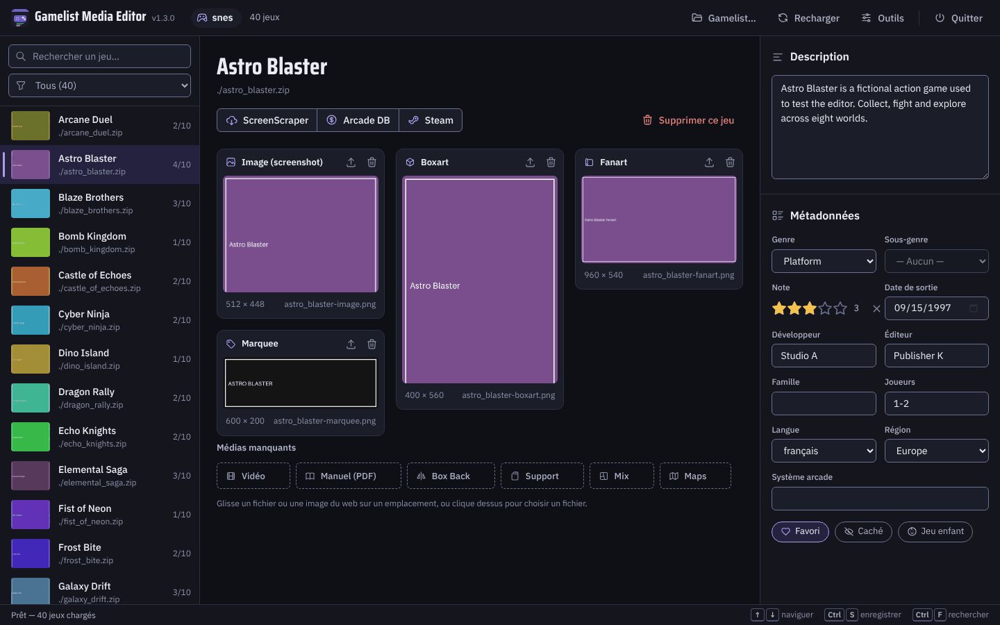

# Gamelist Media Editor

[](https://github.com/Kraran/gamelist-media-editor/actions/workflows/tests.yml)

Local web app to edit the media and metadata of EmulationStation **RetroBat** (and Batocera / Recalbox) `gamelist.xml` files, with drag-and-drop and built-in scrapers.

**Version 1.3.0** · [Documentation (Wiki)](https://github.com/Kraran/gamelist-media-editor/wiki) · [Releases](https://github.com/Kraran/gamelist-media-editor/releases) · [Changelog](CHANGELOG.md)



---

## Features

**Media**
- **Media gallery**: each media shown in its own shape (upright boxes, wide logos…) with its size in pixels; missing media grouped below
- Drag-and-drop (file or image from a web page) or click to choose a file, for **image**, **video**, **marquee**, **manual**, **boxback**, **support** (`cartridge`), **boxart**, **fanart**, **mix**, **maps**
- RetroBat extras handled automatically: **thumbnail**, **bezel**, **Pad2Key** (`.keys`)
- Image lightbox, upload limit 50 MB, previous file removed when a media is replaced

**Metadata**
- Name, description, genre, rating (**stars**), release date (**date picker**), developer, publisher, family, players, language and region (**named lists**), `arcadesystemname`; suggestions from the values already in the gamelist
- **One save bar** for all changes (`Ctrl+S`), with the changed fields marked and *Discard changes*; one write of `gamelist.xml` per save
- RetroBat flags **favorite** / **hidden** / **kidgame**

**Scrapers** (field by field, you choose what to apply)
- **ScreenScraper**: ROM hash match (also inside `.zip`), then name search with a candidate list; media types configurable; system detected from the RetroBat folder name (all RetroBat systems)
- **Arcade Database**: MAME / FBNeo / Neo-Geo / Atomiswave (PCB → Support, Cabinet → Boxart, Flyer → Boxback, Decal → Marquee) and arcade hardware name (`cps1.cpp` → CPS1)
- **Steam**: trailer download (French when available, 720p if ≤ 50 MB, else 480p)

**Workflow**
- Game list with **thumbnails** and a **media count** per game (hover it to see what is missing); fast with very large gamelists (a 30,000-game MAME list opens in about a second)
- Filter games by **missing media** (counts per media), search, keyboard navigation, `Ctrl+S` save, `Ctrl+F` search
- **Open another `gamelist.xml`** at any time (file browser + recent files), **Reload** after an outside edit
- **Tools**: language, ScreenScraper member login and media types, `.bak` backup, purge all `<region>` tags
- Delete a game (ROM + media + XML entry) with optional backup
- Application window without address bar when Edge / Chrome / Brave is available; **Quit** stops the server
- **13 languages**

**Safety**
- Server bound to `127.0.0.1`; requests from other websites (CSRF) and foreign `Host` headers (DNS rebinding) are rejected
- Every action on a game checks the game's `<path>`: if `gamelist.xml` changed meanwhile, the action reaches the right game or is refused, never another one
- Media paths confined to the gamelist folder, serialized XML writes

---

## Installation

### Option A — Windows executable (recommended)

1. Download **`GamelistMediaEditor-Windows-v1.3.0.zip`** from the [v1.3.0 release](https://github.com/Kraran/gamelist-media-editor/releases/tag/v1.3.0)
2. Extract anywhere and run **`GamelistMediaEditor.exe`** (no Python needed)
3. The app window opens on http://127.0.0.1:5050 — use **📂 Gamelist…** to open a `gamelist.xml`

Tip: drag a `gamelist.xml` onto the `.exe` to open it directly.

### Option B — From source (Python)

1. Clone the repository, or download **Source code (zip)** from the [latest release](https://github.com/Kraran/gamelist-media-editor/releases/latest)
2. Install **Python 3.9+** from [python.org](https://www.python.org/downloads/) (tick *Add to PATH*)
3. In the app folder:

   ```bash
   python -m pip install -r requirements.txt
   ```

4. Run **`Lancer.bat`** (Windows), or:

   ```bash
   python app.py "C:\path\to\gamelist.xml"
   ```

   The gamelist argument is optional.

Optional: `Creer-Raccourci.ps1` creates a desktop shortcut to `Lancer.bat` with the app icon.

Your `screenscraper_config.json` (member login, media types) is stored next to `app.py` / the `.exe`. Keep it when you update.

---

## Usage

1. Open your system's `gamelist.xml` (for example `RetroBat\roms\snes\gamelist.xml`). Media go to `images/`, `videos/` and `manuals/` next to it.
2. Select a game, then drop files on the media zones or use **ScreenScraper**, **Arcade DB** or **Steam**.
3. Edit the metadata and save (`Ctrl+S`).
4. Use **Tools** for global actions, **Reload** if you edited the XML outside the app.

Please use the scrapers responsibly: requests are throttled, avoid hammering the APIs. ScreenScraper works out of the box; a free member account (Tools) raises your quota.

---

## Requirements

- Windows executable: nothing else
- From source: Python **3.9+** with `flask`, `lxml`, `requests`, `Pillow` (`requirements.txt`)
- A modern browser (Edge, Chrome, Brave, Firefox)
- Internet access only for the scrapers

---

## Development

```bash
python -m pip install -r requirements.txt -r requirements-dev.txt
python -m pytest -q                      # unit and API tests
python -m playwright install chromium    # once, for the browser tests
python -m pytest -m e2e -q               # browser tests: the real UI in Chromium
```

Code layout (`app.py` is only the entry point; the overview is in `gme/__init__.py`):

| Path | Role |
|---|---|
| `gme/main.py`, `gme/server.py` | start-up, Flask app, request guards, blueprints |
| `gme/editor.py` | editor routes: list, open gamelist, media, metadata, tools |
| `gme/scrapers/ss.py`, `adb.py`, `steam.py` | ScreenScraper, Arcade Database, Steam (client, parsing, routes) |
| `gme/scrapers/common.py` | throttling, name matching, ROM hashes |
| `gme/xml_store.py` | the open `gamelist.xml`: path, cache, writes, game lookup |
| `gme/thumbs.py` | list thumbnails (`/api/thumb`), cached in `cache/thumbs/` next to `app.py` or the `.exe` |
| `gme/media.py`, `gme/systems.py`, `gme/arcade.py` | media files, ScreenScraper system ids, arcade hardware names |
| `gme/security.py`, `gme/i18n.py`, `gme/window.py` | local-only guards, server messages, app window |
| `templates/`, `static/` | UI (`app.js`, `style.css`, `locales/*.json`) |

- The game list is virtualized (`renderList` / `renderListWindow` in `app.js`): only the rows in view exist in the page. `/api/games` sends the non-empty fields without descriptions; `/api/game/<index>` returns one game with its description
- `xml_store.XML_PATH` / `xml_store.BASE_DIR` change when another gamelist is opened: read them through the module, never import the names
- Version: `APP_VERSION` and `APP_RELEASE_DATE` in `gme/version.py` are the only places to change (header, About dialog, User-Agent, console)
- `python app.py --no-browser [gamelist.xml]` starts the server without opening a window
- GitHub Actions runs the tests on Windows and Linux (Python 3.9 and 3.13), the browser tests in Chromium, and builds the Windows `.exe`, starts it and queries it, for every push and pull request (the `.exe` is downloadable from the run for 14 days)
- Windows executable locally: `BUILD_EXE.bat` (PyInstaller, output in `dist/`)

Interface:

- Layout: game list (left), media of the selected game (center), description and metadata (right); below 1100 px wide the metadata moves under the media
- Design tokens (colors, type, spacing) are CSS variables at the top of `static/style.css`; dark is the default theme, a light theme only needs a `[data-theme="light"]` block redefining the color tokens
- Icons come from `templates/_icons.svg` (Tabler Icons, MIT): use `icon("name")` in `app.js` or `{{ icon("name") }}` in the template; to add one, copy its `<symbol>` from the Tabler outline set
- Fonts are embedded in `static/fonts/` (IBM Plex Sans for the interface, Saira Condensed for titles; SIL OFL): the app works offline. Third-party licenses: [THIRD_PARTY_NOTICES.md](THIRD_PARTY_NOTICES.md)
- Changes are listed in [CHANGELOG.md](CHANGELOG.md); past release notes are in [docs/release-notes](docs/release-notes/)

---

## Languages

**Français · English · Español · Deutsch · Italiano · Português · Nederlands · Polski · Türkçe · Svenska · Norsk · Dansk · Русский**

Open **Tools → Language**, choose a language, then **Apply language**. The choice is remembered by the browser.

## License

MIT — see [LICENSE](LICENSE)
