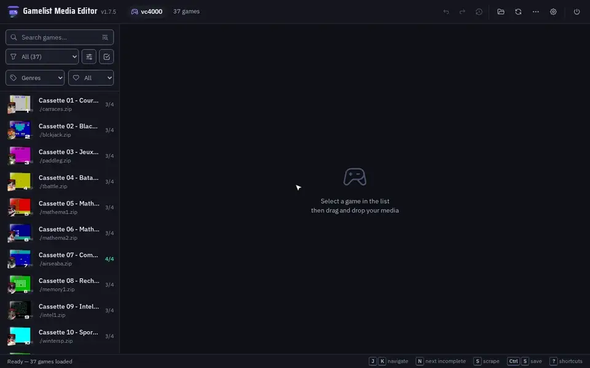
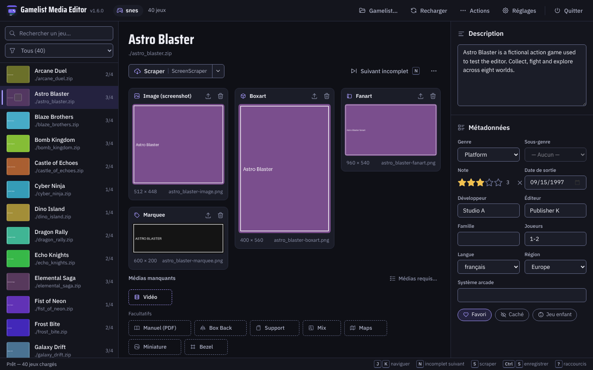
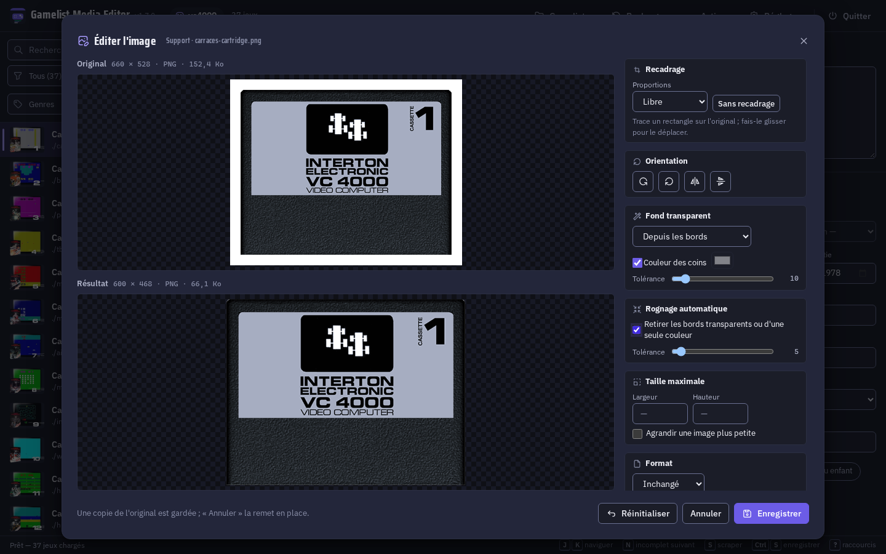
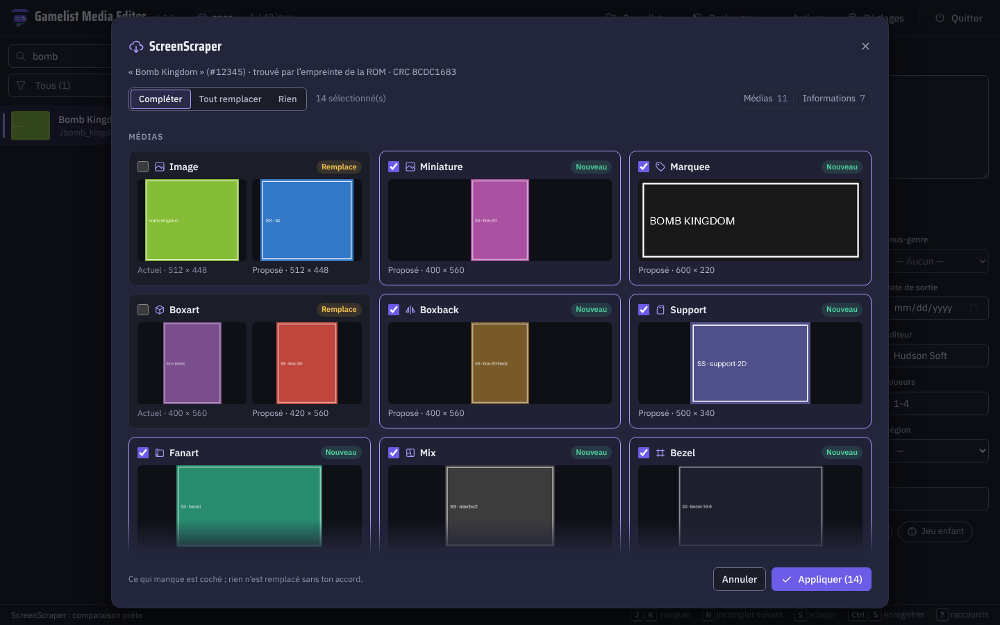
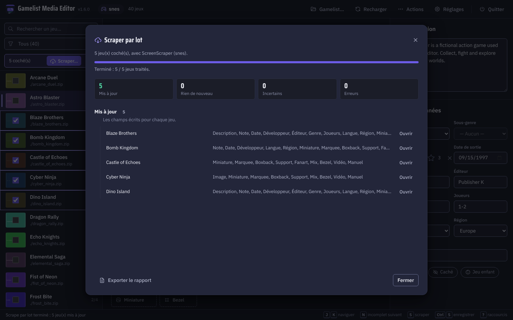
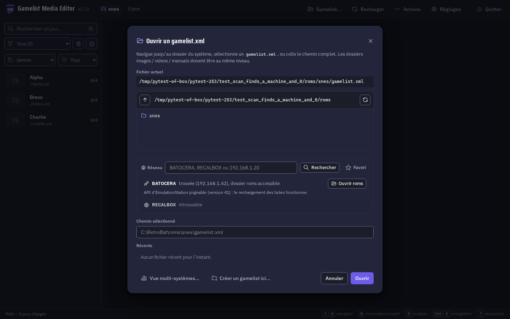
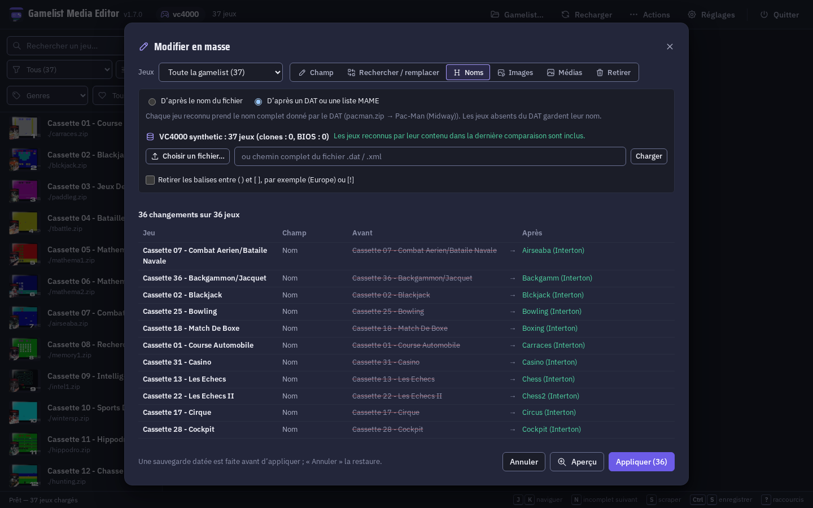
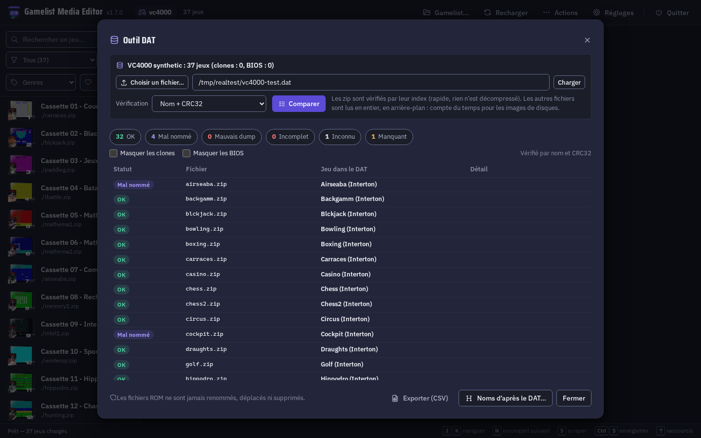
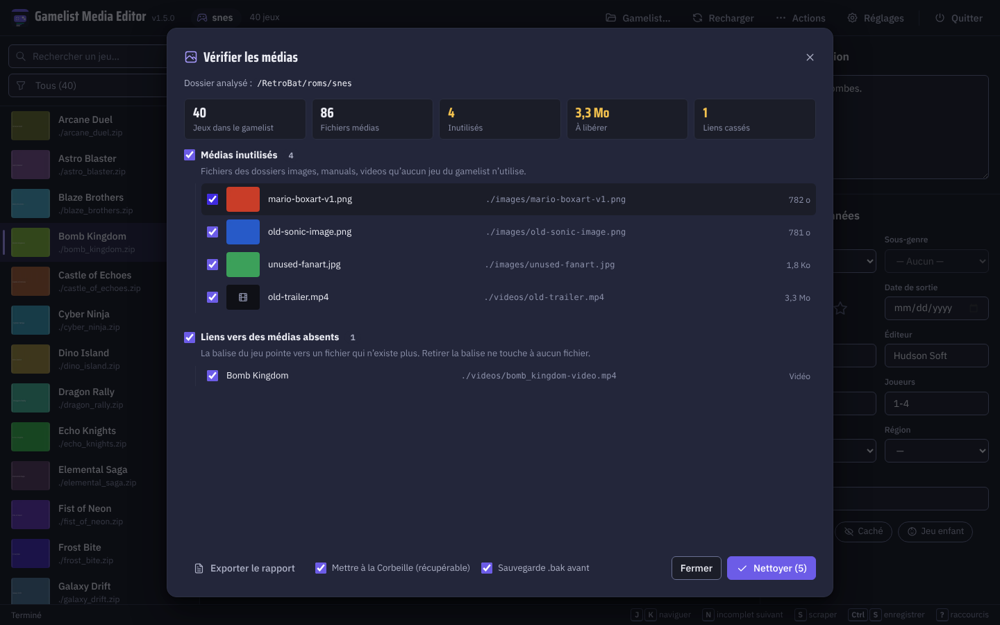

# Gamelist Media Editor

[](https://github.com/Kraran/gamelist-media-editor/actions/workflows/tests.yml)

Local web app to edit the media and metadata of EmulationStation **RetroBat** (and Batocera / Recalbox / **ES-DE**) `gamelist.xml` files, with drag-and-drop and built-in scrapers.

**Version 1.7.5** · [Documentation (Wiki)](https://github.com/Kraran/gamelist-media-editor/wiki) · [Releases](https://github.com/Kraran/gamelist-media-editor/releases) · [Changelog](CHANGELOG.md)

**▶ 45-second demo**: browse, edit, scrape with a preview, media, bulk edit, undo, all your systems at a glance

[](docs/demo/demo.mp4)

[Full-quality MP4](docs/demo/demo.mp4) · [Longer video on YouTube](https://youtu.be/Wj3KJ_8RePc)



---

## Features

**Media**
- **Media gallery**: each media shown in its own shape (upright boxes, wide logos…) with its size in pixels; missing media grouped below
- Drag-and-drop (file or image from a web page) or click to choose a file, for **image**, **video**, **marquee**, **manual**, **boxback**, **support** (`cartridge`), **boxart**, **fanart**, **mix**, **maps**, **thumbnail**, **bezel**, **wheel**, **titleshot** (title screen) and **music** (MP3, OGG, WAV, FLAC, with an audio player)
- RetroBat extra from ScreenScraper: **Pad2Key** (`.keys`)
- Image lightbox, upload limit 50 MB; a replaced file goes to the Recycle Bin, never when another game still uses it
- **Image editor** (the pen-on-picture button of any image tile: image, thumbnail, marquee, wheel, titleshot, boxart, cartridge, mix, fanart…): crop (free or 1:1, 4:3, 3:4, 16:9, 9:16, 2:1, 3:1, original), rotate 90° and flip, **transparent background** for logos (the colour touching the edges, or one colour everywhere, with a tolerance; shown over a checkerboard), **auto-trim** of transparent or single-colour borders, maximum width / height (keeps the proportions), PNG / JPG / WebP with a quality setting. The preview is rendered by the app (Pillow) as you change a setting; *Save* replaces the file (a copy of the original is kept; a new format gets the new extension and the gamelist path follows) or writes a new `-edit` file next to it. A file another media also uses is never overwritten. The toast's **Undo** puts the original back



**Metadata**
- Name, description, genre, rating (**stars**), release date (**date picker**), developer, publisher, family, players, language and region (**named lists**), `arcadesystemname`; suggestions from the values already in the gamelist
- **One save bar** for all changes (`Ctrl+S`), with the changed fields marked and *Discard changes*; one write of `gamelist.xml` per save
- RetroBat flags **favorite** / **hidden** / **kidgame**

**Scrapers**
- **One Scrape button**: the right source for the system (Arcade Database for arcade folders, Steam for `steam`, ScreenScraper otherwise); the ▾ menu forces another one, remembered per system
- **Comparison before applying**: current and proposed values side by side, images with their size; only what is missing is ticked, nothing is replaced unless you tick it (*Fill gaps* / *Replace all* / *None*)
- Proposed images are downloaded once and reused when applied (no second ScreenScraper download)
- **Downloaded images are checked** before they are written: an unreadable or corrupt file (or an error page), a picture under 16 px or 32×32 px, or a single-colour / fully transparent image is refused and reported as failed in the scrape and batch reports; the game keeps its previous media (videos and manuals are not checked)
- **Batch scrape**: the games ticked in the list (box, `Ctrl`/`Shift`+click, `X`), or all the games shown; fill gaps or replace, chosen fields, progress with *Stop*, report of the updated, uncertain (pick them afterwards) and failed games
- **Parallel ScreenScraper batches**: with a member login, several games at once, never more than the `maxthreads` ScreenScraper gives your account (1 without a login); requests per minute and the daily quota are respected for every request of the app, and results are still written in list order. *Settings › ScreenScraper › Threads* can lower the number
- **ScreenScraper answer cache**: game lookups are kept on disk (`cache/ss-api/`, 30 days by default, *Game not found* only 1 day, errors never), so rescraping a game sends no request and uses none of your quota. Credentials are never stored. *Settings › ScreenScraper* turns it off, sets how long answers are kept and empties it; the scrape and batch windows can ignore it to ask ScreenScraper again.
- **ScreenScraper media per type** (*Settings › ScreenScraper media*): for each media, the ScreenScraper type (e.g. `ss` or `sstitle`, `box-2D` or `box-3D`, `wheel-hd`, `wheel`, `screenmarquee`… for the marquee, `mixrbv1`/`mixrbv2`, `bezel-16-9`/`bezel-4-3`, normalized or original video), the region tried first, and whether ScreenScraper proposes it at all. The defaults are what earlier versions asked for; **wheel** and **titleshot** are new and off until you tick them. ScreenScraper has no music for games: add the file yourself.
- **Resume / retry**: *Last batch* below the game list reopens the saved report for this gamelist. Resume the remaining games after stopping or reopening the app; once finished, retry only failed games and failed fields of partial updates. A new batch starts from *Actions* or the selection bar and replaces the previous saved report
- **ScreenScraper**: ROM hash match (also inside `.zip`), then name search with a candidate list; media type, region and on/off per media; system detected from the RetroBat folder name (all RetroBat systems)
- **Fallback sources** (*Settings › Fallback sources*, all off until you tick them): **LaunchBox Games Database** (no key: its free daily database is downloaded once, ~110 MB, and read locally, ~250 MB in `cache/launchbox/`), **TheGamesDB** (your own API key, asked for on the [TheGamesDB forum](https://forums.thegamesdb.net/), small monthly allowance) and **IGDB** (your own Twitch application: Client ID + Client Secret from the [Twitch developer console](https://dev.twitch.tv/console/apps), free for non-commercial use). They fill what ScreenScraper does not have — the game, one field or one media — or everything once its quota is reached (*carry on* setting: no more ScreenScraper requests; otherwise the batch stops as before), in a chain order you set (ScreenScraper first by default) and for the fields you tick per source. Single scrape, batch scrape and actions on several systems; the scrape window shows a chip with the source of each field that does not come from ScreenScraper. Matching: ROM CRC (TheGamesDB) then name on the system's platform, alternate names (LaunchBox). TheGamesDB and IGDB answers are cached like ScreenScraper's, keys are never shown again, logged or cached, and each source is asked one request at a time (TheGamesDB 1/s and stops at the end of its allowance, IGDB 0.3 s apart). Texts are in English; images belong to their authors (personal use)
- **Arcade Database**: MAME / FBNeo / Neo-Geo / Atomiswave (PCB → Support, Cabinet → Boxart, Flyer → Boxback, Decal → Marquee) and arcade hardware name (`cps1.cpp` → CPS1)
- **Steam**: trailer download (French when available, 720p if ≤ 50 MB, else 480p)





**Workflow**
- **ES-DE support**: open `ES-DE/gamelists/<system>/gamelist.xml` (installer or Windows portable release), or the `ES-DE` folder for the multi-system overview. GME detects the layout from `es_settings.xml` (`ROMDirectory`, `MediaDirectory`, `~`, `%ESPATH%`, `custom_systems/es_systems.xml`) and works the ES-DE way: media are found by the ROM's name in `downloaded_media/<system>/<type>/` (covers, screenshots, titlescreens, marquees, 3dboxes, backcovers, physicalmedia, fanart, miximages, videos, manuals), and every add, replace, scrape (ScreenScraper, fallback sources, batch, several systems) or removal writes, replaces or bins that file. No media tag is ever written to an ES-DE gamelist and its own tags (`altemulator`, `<folder>`…) are kept. Media ES-DE has no folder for (wheel, map, bezel, music, Pad2Key) are not offered. See the [ES-DE wiki page](https://github.com/Kraran/gamelist-media-editor/wiki/ES-DE)
- **Network shares** (Batocera, Recalbox, a RetroBat PC): open and save a gamelist and its media straight on the machine through its SMB share. *Gamelist… › Network › Search* finds `BATOCERA` and `RECALBOX` (or a name / IP you type) and opens their `roms` folder; type `\\BATOCERA\share\roms\snes` (or `\\BATOCERA` for its shares) in the path field. Favourite folders, a sign-in form for protected shares (Batocera *Enforce security*: `root`), short time limits and clear messages when the machine is off, atomic saves, dated backups kept on this PC, and an optional reload of the game lists after saving through Batocera's documented EmulationStation API (`:1234/reloadgames`, needs *Enable public web access*). Windows opens `\\host\share` paths natively; on Linux / macOS mount the share first. See the [Network wiki page](https://github.com/Kraran/gamelist-media-editor/wiki/R%C3%A9seau)

  
- **Multi-system overview**: open a whole `roms` folder (RetroBat, Batocera `/userdata/roms`, Recalbox `/recalbox/share/roms`, or the folder above it) with *Gamelist… › Multi-system view…*. Every system folder (a `gamelist.xml` or ROM files; `bios/` and the like are skipped) gets a row with its friendly name: games, ROMs missing on disk, ROM files not in the gamelist, the share of games with an image, thumbnail, marquee, wheel and video on disk (hover for present / broken links / missing), games without description, genre or date, plus totals for the collection. Columns sort both ways; a click opens the system in the editor and the ▾ next to the system name switches to another one or back to the overview. Systems are scanned in the background on 4 threads with a progress bar and *Stop*, and kept in memory until their gamelist or media folders change (*Refresh* reads everything again). A folder without a gamelist offers *Create a gamelist…*; an unreadable `gamelist.xml` is flagged. Read only: the scan writes nothing. The last 6 roms folders are listed in the *Gamelist…* dialog (`recent_roms_roots.json`)
- **Actions on several systems**: tick systems in the overview (or *tick all*), then *Actions on ticked systems…* runs, one system at a time, the ROM check (add the missing ROMs, remove the entries without a ROM), the media check (remove broken links), *Solid images*, *Clear fields* and a scrape with each system's source (games missing a ticked field, or all). ScreenScraper stays within your account's `maxthreads` and requests per minute, and the whole run stops on the daily quota or a ban, with the reason. A dated backup comes before every change; a progress bar shows the system and step, *Stop* ends after the step in progress, and the final report lists what each operation did per system. Files are only deleted (to the Recycle Bin) with their own box ticked and a red confirmation; like the single-system windows, nothing is removed when more than half the ROMs or media look gone. The gamelist open before is opened again at the end
- Game list with **thumbnails** and a **required media count** per game (hover it to see what is missing); fast with very large gamelists (a 30,000-game MAME list opens in about a second)
- **Resizable game list**: drag its right edge to read long names (arrow keys on the focused edge, double-click for the default width); the media tiles shrink as you drag to make room, and the width is kept in `ui_settings.json`
- **Required media per system** (Settings): the media a game needs to be complete (by default image, video, marquee and box art; no box on arcade systems); the count, the *Required media missing* filter and *Next incomplete* follow them
- Filter games by **missing media** (counts per media), by **genre** (main genre, before the `/`) and by **favorite / hidden / not hidden / kids**; each menu counts what its options would show with the other filters
- **Search** in the name and ROM path, or in **every field** (genre, developer, publisher, date, region…) with the toggle at the end of the search box (kept in `ui_settings.json`)
- **Export the list (CSV)** (Actions): the games shown, in the order of the list, for Excel or LibreOffice (UTF-8 with BOM; `;` separator, `,` in English): path, name, genre, date, developer, publisher, players, rating, favorite, hidden, kidgame, region, language, number of media, required media present and missing
- **Copy the ROM paths of the ticked games** (selection bar or game ⋯ menu), one full path per line
- **Column filter** (the sliders button next to the media filter): one column (name, ROM path, genre, developer, date, rating… or a media) and a condition (*contains*, *does not contain*, *starts with*, *ends with*, *equals*, *is empty*, *is not empty*), combined with the search and the other filters
- **Tick every game shown**: `Ctrl+A` in the list or the button next to the filters (search and filters applied)
- **Edit in bulk** (Actions, or the pencil in the selection bar), on the ticked games, the games shown or the whole gamelist, always with a **preview** (before → after) before *Apply*:
  - *Field*: one value for genre, developer, publisher, date (`YYYY`, `YYYY-MM` or `YYYY-MM-DD`), rating, players, language, region, family, arcade system, favorite / hidden / kids (empty clears)
  - *Clear fields*: remove whole tags (`<region>`, `<genre>`, `<desc>`, `<sortname>`, `<playcount>`, `<cheevosId>`…, empty ones included) from the games; each tag shows how many games of the scope have it, and a confirmation names the fields and the number of games. `<name>`, `<path>` and media tags are not offered (media have their own tab)
  - *Find / replace* in the name, the description or any text field (or all of them): plain text or regular expression (`\1` for a group), case-sensitive or not; a name never becomes empty
  - *Names*: the name becomes the ROM file name without its extension, or the full name a DAT or a MAME list gives (`pacman.zip` → `Pac-Man (Midway)`), optionally without the `(Europe)`, `[!]`… tags
  - *Images*: for one media of the games (e.g. every wheel), auto-trim, maximum width / height and/or PNG / JPG / WebP conversion; the preview shows before → after (size, format, weight) for the first 40, images that already fit are left alone; **Undo** puts the originals and the gamelist back
  - *Solid images*: finds the pictures of a single colour or fully transparent (placeholders, blank downloads) among the media types you tick, with a preview (thumbnail, colour, file) and removes their tags. *Also delete the files from disk* (off by default) sends them to the Recycle Bin after a confirmation, but only files inside the gamelist folder that no other tag of any game uses; ROMs are never deleted. **Undo** restores the gamelist, not the files (recover them from the Recycle Bin)
  - *Media*: remove media tags (the files stay on disk)
  - *Remove*: take games out of `gamelist.xml` after a confirmation; their media can also go to the Recycle Bin (off by default, files another game uses are kept); **ROMs are never deleted**
  - Every apply makes a dated backup first and its toast has **Undo** (one step of the history below; files sent to the Recycle Bin are recovered from the Recycle Bin)
- **Undo / Redo, several steps** (the ↶ ↷ buttons at the top, `Ctrl+Z` / `Ctrl+Y` or `Ctrl+Shift+Z`): the last 30 changes of each open gamelist, one step per action (a save, a bulk edit, a ROM / media check, a scrape, a whole batch scrape, an image edit, a backup restored). The tooltip names the step undone or redone; the history button lists them and jumps to any of them, or back to *Before these changes*. A new change drops the steps that were undone. Undo puts `gamelist.xml` back byte for byte (atomic write) and only if nobody else changed it meanwhile: a gamelist edited outside GME resets the history instead of losing that edit. Files are not part of it: what went to the Recycle Bin is recovered there, media files written stay on disk (the step says so before you undo), except image edits, whose originals are put back (that step cannot be redone). In a text field `Ctrl+Z` stays the field's own undo. The history lives in memory, for the session; the dated backups remain the long-term safety net
- **Automatic updates** (Windows `.exe`): at start-up GME asks GitHub, at most once a day and without an account, whether a newer release exists (silent when offline; *Settings › General › Updates* turns it off, *Actions › Check for updates* asks now). A newer version opens a dialog with its release notes: **Update now**, **Later** or **Skip this version**. *Update now* downloads the release zip with a progress bar and *Stop*, checks its **SHA-256** against the release's `SHA256SUMS.txt` (no checksum or a mismatch: refused), keeps only `GamelistMediaEditor.exe` from it, then GME closes, swaps its `.exe` (the previous one is kept in `.gme-update\previous`), restarts with the same gamelist and checks the new version answers, or puts the previous one back. Only files of the official repository's releases are downloaded, over HTTPS; settings, keys, network passwords, recent lists, caches and backups are never touched. From source, the dialog links to the release page
- **Progress and Stop on long scans**: the solid images scan, the ROM check and the media check run in the background with a bar, *X / Y*, the item being read and **Stop**, shown only after a short delay so small gamelists stay instant. A scan only reads: stopping it changes nothing, and the apply that follows reuses its result only when the gamelist and the files did not change since (else it scans again and asks you to review). The DAT tool also shows *file X / Y* while hashing
- **Statistics** (Actions): games, scraped, complete (all required media), with description, rated, dated, favorites, hidden, played and play time; per media present / broken (tag without file) / missing, with *Show* to list the games missing it; main genres
- **DAT tool** (Actions): load a No-Intro, Redump, FBNeo or MAME DAT you have (Logiqx XML, MAME `-listxml` or ClrMamePro text; nothing is bundled) and compare the system's ROMs with it, by file name or, if you ask, by CRC32 (zip index, fast) / SHA1, in the background with progress: OK, misnamed, bad dump, incomplete romset, unknown and missing games, clone / BIOS / CHD flags, filters and CSV export. It never renames, moves or deletes ROM files; display names can then be taken from the DAT (*Edit in bulk* › *Names*)
- **New gamelist from a ROM folder** (*Gamelist…* › *Create a gamelist here…*): one `<game>` per ROM with the usual extensions of the system (editable), preview, then the new `gamelist.xml` opens; a folder that already has one gets *Add the missing ROMs…* (Check ROMs)





- **Next incomplete** (`N`): jumps to the next game in the list that is missing a required media (or that matches the media filter)
- **Keyboard**: `J`/`K` next/previous game, `N` next incomplete, `S` scrape, `Ctrl+S` save, `Ctrl+Z` / `Ctrl+Y` undo / redo, `Ctrl+F` or `/` search, `?` shows the list
- **Open another `gamelist.xml`** at any time (file browser, the 10 most recent files in one click), **Reload** after an outside edit
- **Actions** menu (whole gamelist): `.bak` backup, arcade system names from `mame.xml`, **Check ROMs** (gamelist vs files of the folder: add missing ROMs, remove entries without ROM, merge duplicates, export the report), **Check media** (unused media to the Recycle Bin, links to missing files removed, export the report)
- **Settings**: theme (dark, light or as the system), language, ScreenScraper member login, region, threads, answer cache, media type / region / on-off per media, fallback sources (order, keys, fields, LaunchBox download), scrape source and required media per system, keyboard shortcuts (kept in `ui_settings.json`)
- Game ⋯ menu: copy the ROM path, delete the game (ROM, tracks / discs, media and XML entry, listed before; files another game uses are kept; to the Recycle Bin) with optional backup
- **Backups and restoration** (Actions): the last 30 dated XML copies, with confirmation before restoring and a snapshot of the current XML to undo the restoration. ROMs and media are not restored
- Application window without address bar when Edge / Chrome / Brave is available; **Quit** stops the server
- **13 languages**



**Safety**
- Server bound to `127.0.0.1`; requests from other websites (CSRF) and foreign `Host` headers (DNS rebinding) are rejected
- Every action on a game checks the game's `<path>`: if `gamelist.xml` changed meanwhile, the action reaches the right game or is refused, never another one
- Media paths confined to the gamelist folder, serialized XML writes
- Gamelist operations finish before switching files; older tabs and batches are refused after a switch. A persistently locked file is kept intact and the failed save is reported.

---

## Installation

### Option A — Windows executable (recommended)

1. Download **`GamelistMediaEditor-Windows-v1.7.5.zip`** from the [v1.7.5 release](https://github.com/Kraran/gamelist-media-editor/releases/tag/v1.7.5)
2. Extract anywhere and run **`GamelistMediaEditor.exe`** (no Python needed)
3. The app window opens on http://127.0.0.1:5050 — use **Gamelist…** to open a `gamelist.xml`

Tip: drag a `gamelist.xml` onto the `.exe` to open it directly.

Updates: from the next release on, GME offers new versions itself (see *Automatic updates* above). To go back to the previous version after an update, close GME and copy `.gme-update\previous\GamelistMediaEditor.exe` over `GamelistMediaEditor.exe`.

### Option B — From source (Python)

1. Clone the repository, or download **Source code (zip)** from the [latest release](https://github.com/Kraran/gamelist-media-editor/releases/latest)
2. Install **Python 3.9+** from [python.org](https://www.python.org/downloads/) (tick *Add to PATH*)
3. In the app folder:

   ```bash
   python -m pip install -r requirements.txt
   ```

4. Run **`Lancer.bat`** (Windows), or:

   ```bash
   python app.py "C:\path\to\gamelist.xml"
   ```

   The gamelist argument is optional.

Optional: `Creer-Raccourci.ps1` creates a desktop shortcut to `Lancer.bat` with the app icon.

Your `screenscraper_config.json` (member login, media types, cache settings), `sources_config.json` (fallback sources: order, fields, TheGamesDB / IGDB keys), `ui_settings.json` (language, scrape sources, required media) `recent_gamelists.json` (recently opened gamelists) and `recent_roms_roots.json` (roms folders of the multi-system overview) are stored next to `app.py` / the `.exe`. Keep them when you update.

Keep `state/batches/` next to the app to retain batch progress and reports. XML snapshots travel with the gamelist in `.gme-backups/<XML filename>/`; each backup also updates the traditional `<XML filename>.bak`. After closing the browser, the game already in progress can finish and checkpoint, then the batch waits for an explicit resume. After an abrupt server shutdown, the last interrupted game may be checked again.

---

## Usage

1. Open your system's `gamelist.xml` (for example `RetroBat\roms\snes\gamelist.xml`). Media go to `images/`, `videos/` and `manuals/` next to it. Or open the whole `roms` folder (*Multi-system view…*) to see every system at once and pick one. On the network: `\\BATOCERA\share\roms\snes\gamelist.xml` (or *Network › Search* in the dialog). ES-DE: open `ES-DE\gamelists\snes\gamelist.xml` (media go to `ES-DE\downloaded_media\snes\…`, named after the ROM), or the `ES-DE` folder for the overview.
2. Select a game, then drop files on the media, or click **Scrape**, check what changes and apply (Enter).
3. Edit the metadata and save (`Ctrl+S`).
4. Use **Actions** for the whole gamelist (backup, checks, edit in bulk…), **Reload** if you edited the XML outside the app.

Please use the scrapers responsibly: requests are throttled, avoid hammering the APIs. ScreenScraper works out of the box; a free member account (Settings › ScreenScraper) raises your quota.

ScreenScraper limits are applied to every request the app sends (API calls and media downloads, single scrapes, previews and batches together): never more simultaneous requests than the `maxthreads` of your account (1 without a member login), at most `maxrequestspermin` per minute (with a 10 % margin), and nothing once the daily quota is used. These numbers come from ScreenScraper's own answers and are re-read with each one. A "too many threads" answer (HTTP 429) drops to one thread for two minutes; a daily quota (430/431), closed API (423) or refused software (426) answer stops the batch and nothing more is sent for a while. The *Threads* setting can only lower the number of threads. Answers served from the cache are not requests: they take no thread and do not count against the quota.

---

## Requirements

- Windows executable: nothing else
- From source: Python **3.9+** with `flask`, `lxml`, `requests`, `Pillow`, `Send2Trash` (`requirements.txt`)
- A modern browser (Edge, Chrome, Brave, Firefox)
- Internet access only for the scrapers

---

## Development

```bash
python -m pip install -r requirements.txt -r requirements-dev.txt
python -m pytest -q                      # unit and API tests
python -m playwright install chromium    # once, for the browser tests
python -m pytest -m e2e -q               # browser tests: the real UI in Chromium
```

Code layout (`app.py` is only the entry point; the overview is in `gme/__init__.py`):

| Path | Role |
|---|---|
| `gme/main.py`, `gme/server.py` | start-up, Flask app, request guards, blueprints |
| `gme/editor.py` | editor routes: list, open gamelist, media, metadata, gamelist actions |
| `gme/scrapers/ss.py`, `adb.py`, `steam.py` | ScreenScraper, Arcade Database, Steam (client, parsing, routes) |
| `gme/scrapers/compare.py`, `apply.py` | current vs proposed per field (statuses, presets), applying a scrape (shared by the three sources) |
| `gme/scrapers/common.py` | throttling, name matching, ROM hashes |
| `gme/romcheck.py` | Check ROMs: gamelist compared with the files of its folder, update (`/api/check-roms`) |
| `gme/mediacheck.py` | Check media: unused media files and links to missing files, clean-up (`/api/check-media`) |
| `gme/recent.py` | recently opened gamelists (`recent_gamelists.json` next to `app.py` or the `.exe`) |
| `gme/settings.py` | interface settings: language, scrape source and required media per system (`ui_settings.json`, `/api/settings`) |
| `gme/batch_jobs.py` | durable batch plans and per-game checkpoints, resume ownership and selective retry, parallel ScreenScraper lookups applied in list order (`/api/batch`) |
| `gme/scrapers/ss_limits.py` | ScreenScraper limits for the whole process: `maxthreads` semaphore, requests-per-minute limiter, daily quotas, 429/430/431 handling |
| `gme/scrapers/fallback.py`, `sources.py` | ScreenScraper then the fallback sources field by field (chain order, allowed fields, quota "carry on"), their settings (`sources_config.json`), answer cache (`cache/sources-api/`) and throttles; routes `/api/sources/*` |
| `gme/scrapers/launchbox.py`, `tgdb.py`, `igdb.py`, `platforms.py` | LaunchBox Games Database (daily `Metadata.zip` → local SQLite index), TheGamesDB (API key, allowance), IGDB (Twitch app token), platform ids of each source per ScreenScraper system |
| `gme/scrapers/ss_cache.py` | On-disk cache of ScreenScraper game lookups (`cache/ss-api/`): keys without credentials, TTL, never caches errors |
| `gme/backups.py` | dated XML snapshots, bounded history and reversible restoration (`/api/backups`) |
| `gme/imageedit.py` | image editor and batch image edits (Pillow): preview, save with a copy of the original, undo (`/api/image-edit`) |
| `gme/solidimages.py` | *Solid images*: one-colour or transparent pictures, their tags removed and, on request, their unused files sent to the Recycle Bin (`/api/solid-images`) |
| `gme/bulk.py` | edit in bulk and removing many games: preview then one backup and one write (`/api/bulk`, `/api/bulk-delete`; `/api/bulk/fields` counts the tags for *Clear fields*) |
| `gme/datfile.py`, `gme/dattool.py` | DAT reading (Logiqx XML, MAME listxml, ClrMamePro) and the DAT tool: background load and comparison, report (`/api/dat`) |
| `gme/newgamelist.py` | new gamelist from a ROM folder, extensions per system (`/api/new-gamelist`) |
| `gme/stats.py` | statistics of the open gamelist (`/api/stats`) |
| `gme/overview.py` | multi-system overview of a `roms` folder: system folders, friendly names, background scan with cache (`/api/overview`) |
| `gme/multibatch.py` | actions on several systems: one system at a time through the single-system routes, quota stop, report (`/api/multibatch`) |
| `gme/gamedelete.py` | deleting a game: dry run listing its files, then the Recycle Bin (`/api/delete-game`) |
| `gme/remote_cache.py` | proposed images: previews (`/api/scrape/preview/<key>`), kept in `cache/remote/` and reused when applied |
| `gme/xml_store.py` | the open `gamelist.xml`: path, cache, writes, game lookup |
| `gme/thumbs.py` | list thumbnails (`/api/thumb`), cached in `cache/thumbs/` next to `app.py` or the `.exe` |
| `gme/fields.py` | metadata validation and XML setters (editor and scrapers) |
| `gme/media.py`, `gme/systems.py`, `gme/arcade.py` | media files, ScreenScraper system ids and default scraper per system, arcade hardware names |
| `gme/security.py`, `gme/i18n.py`, `gme/window.py` | local-only guards, server messages, app window |
| `templates/`, `static/` | UI (`app.js`, `style.css`, `locales/*.json`) |

- The game list is virtualized (`renderList` / `renderListWindow` in `app.js`): only the rows in view exist in the page. `/api/games` sends the non-empty fields without descriptions; `/api/game/<index>` returns one game with its description
- Scrapers return a `proposed` dict (same shape for the three sources); `compare.compare_rows` gives each field a status (`new`, `different`, `replace`, `same`, `unavailable`) and the apply routes take either the ticked `fields` or a `preset` (`missing`, `all`)
- `xml_store.XML_PATH` / `xml_store.BASE_DIR` change when another gamelist is opened: read them through the module, never import the names
- Version: `APP_VERSION` and `APP_RELEASE_DATE` in `gme/version.py` are the only places to change (header, About dialog, User-Agent, console)
- `python app.py --no-browser [gamelist.xml]` starts the server without opening a window
- GitHub Actions runs the tests on Windows and Linux (Python 3.9 and 3.13), the browser tests in Chromium, and builds the Windows `.exe`, starts it and queries it, for every push and pull request (the `.exe` is downloadable from the run for 14 days)
- Windows executable locally: `BUILD_EXE.bat` (PyInstaller, output in `dist/`)
- Releases: push a tag `vX.Y.Z` (matching `gme/version.py`); the *Release* workflow builds the `.exe`, zips it with `tools/release_assets.py` and publishes `GamelistMediaEditor-Windows-vX.Y.Z.zip` **and `SHA256SUMS.txt`** on the release (draft until both are attached). The in-app updater refuses a release without that checksum file. *Actions › Release › Run workflow* re-attaches them to an existing tag
- Demo video: `python tools/record_demo.py <system folder> <out>` records it with Playwright on a copy (fake scraper, offline), `tools/encode_demo.sh <out>/demo.webm docs/demo` makes the README's animated WebP and the MP4

Interface:

- Layout: game list (left, resizable: `--w-list` on `.main`, clamped so the editor keeps 600 px), media of the selected game (center), description and metadata (right); below 1100 px wide the metadata moves under the media
- Design tokens (colors, type, spacing) are CSS variables at the top of `static/style.css`; dark is the default theme, a light theme only needs a `[data-theme="light"]` block redefining the color tokens
- Icons come from `templates/_icons.svg` (Tabler Icons, MIT): use `icon("name")` in `app.js` or `{{ icon("name") }}` in the template; to add one, copy its `<symbol>` from the Tabler outline set
- Fonts are embedded in `static/fonts/` (IBM Plex Sans for the interface, Saira Condensed for titles; SIL OFL): the app works offline. Third-party licenses: [THIRD_PARTY_NOTICES.md](THIRD_PARTY_NOTICES.md)
- Changes are listed in [CHANGELOG.md](CHANGELOG.md); past release notes are in [docs/release-notes](docs/release-notes/)

---

## Languages

**Français · English · Español · Deutsch · Italiano · Português · Nederlands · Polski · Türkçe · Svenska · Norsk · Dansk · Русский**

Open **Settings › General** and pick a language: it applies at once and is remembered (`ui_settings.json`).

## License

MIT — see [LICENSE](LICENSE)
