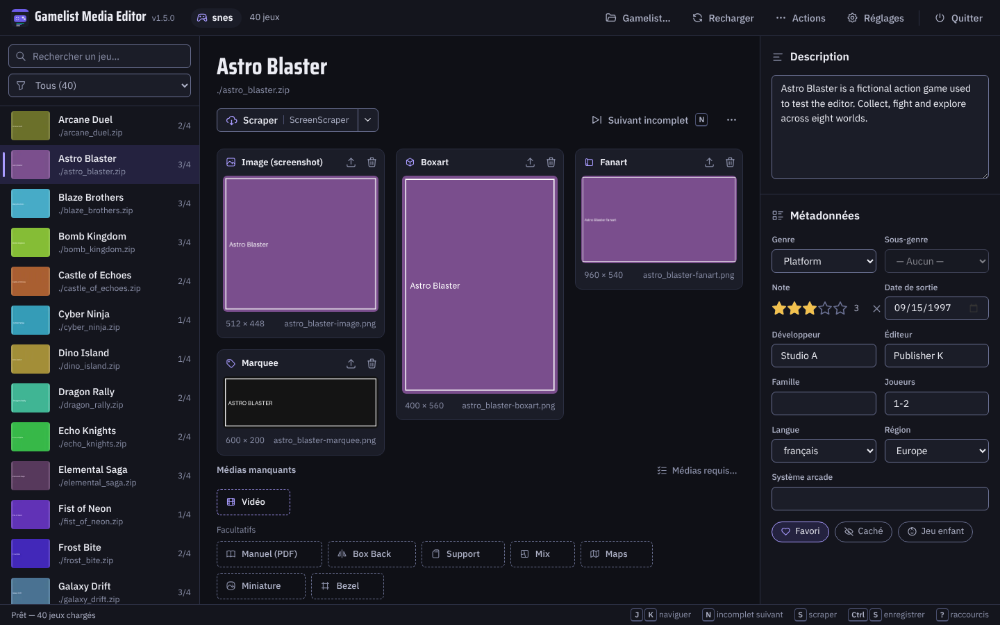
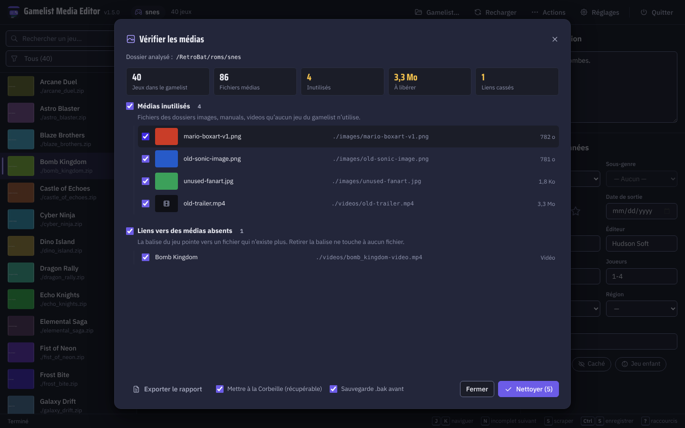

# Gamelist Media Editor v1.5.0

Check your gamelist against your ROMs and your media, decide which media each system needs, and never lose a file by mistake.

## Highlights

**Check ROMs** (Actions menu)
- Compares the gamelist with the files of its folder: **ROMs missing from the gamelist**, **entries whose ROM is gone**, **games listed twice**
- Tick what to change, then *Update the gamelist*: missing ROMs are added (ready to scrape), dead entries removed (optionally with their media), duplicates merged into the most complete entry; `.bak` first
- Understands `.cue` / `.gdi` / `.m3u` tracks and discs, folders such as `Game.ps3`, and MAME: `.chd` disks are never offered as games
- *Export the report* as a text file; 30,000 files checked in under a second

**Check media** (Actions menu)
- **Unused media** in `images/`, `videos/`, `manuals/` (with thumbnails and the size to free) and **links to missing files**
- *Clean up* moves the unused files to the **Recycle Bin** and removes the broken tags; a file any game uses is never offered

**Required media per system**
- Choose, per system, the media a game must have to be complete (by default image, video, marquee and box art; no box on arcade systems)
- The list count (`3/4`), the *Required media missing* filter and *Next incomplete* (`N`) follow them; a game's missing required media come first
- **Thumbnail** and **Bezel** are now visible and editable in the editor

**Safer with your files**
- *Delete this game* lists exactly what goes (ROM, its tracks or discs, the folder named like the ROM, the `.keys` file, the media) and **keeps what another game uses**; everything goes to the **Recycle Bin**
- Replacing a media sends the old file to the Recycle Bin, and never deletes or overwrites a file another game uses
- In a confirmation, **Enter on *Cancel* no longer confirms**; a dialog that deletes something opens with the focus on *Cancel*

## Other changes

- Up to **10 recent gamelists**, opened in one click and kept next to the app (they were sometimes forgotten)
- Language, scrape sources and required media are kept in `ui_settings.json` next to the app; ScreenScraper settings save as they change; 24 preferred regions instead of 5
- Media gallery: images are no longer cut; a replaced picture shows at once
- Keyboard: Tab stays inside the open dialog; Enter applies the scrape after ticking a row; the comparison has *Media* / *Information* shortcuts
- *Purge `<region>`* refreshes the open game; *About* mentions Steam

Full list: [CHANGELOG.md](https://github.com/Kraran/gamelist-media-editor/blob/v1.5.0/CHANGELOG.md)

## Downloads

| File | Description |
|------|-------------|
| `GamelistMediaEditor-Windows-v1.5.0.zip` | Standalone Windows `.exe` (no Python needed) |
| Source code (zip / tar.gz) | Python 3.9+ (`pip install -r requirements.txt`) |

## Upgrade from 1.4.0

Replace the app files and keep `screenscraper_config.json`, `recent_gamelists.json` and, from now on, `ui_settings.json`. Nothing to migrate in `gamelist.xml`; your language and scrape sources are taken over at first start.  
From source: run `python -m pip install -r requirements.txt` (new dependency **Send2Trash**, for the Recycle Bin).  
The list count now counts the **required media** of the system: pick them in **Settings › Required media**.
