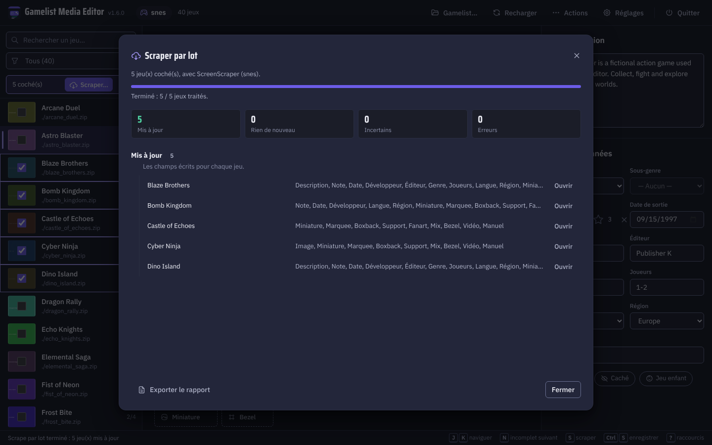
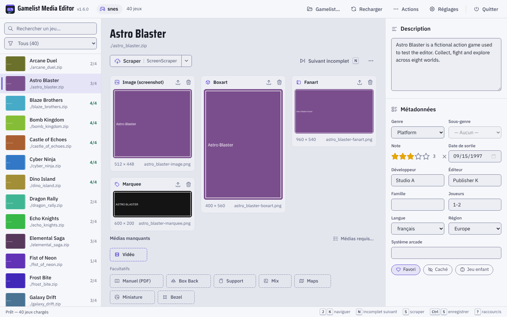

# Gamelist Media Editor v1.6.0

Scrape a whole list of games in one go, work in a light theme, and every text of the interface in your language.

## Highlights

**Batch scrape** (Actions › *Scrape in batch*, or *Scrape…* in the selection bar)
- Scrapes the games **ticked** in the list, or else **every game shown** (search and filter: the *Required media missing* filter gives all incomplete games)
- Tick a game with the box on its thumbnail, `Ctrl`+click or `X`; `Shift`+click ticks every game shown in between; `Esc` unticks all
- *Fill gaps* (only empty fields) or *Replace all*, with the media and information to write (the name and Pad2Key are off by default); a `.bak` is made first
- A progress bar shows each game; *Stop* ends after the game in progress; a refused ScreenScraper (quota, login, API closed) ends the run instead of failing every game
- The report lists the games **updated** (with their fields), **uncertain** (the source offers several games: nothing is written, *Choose…* opens the game's scrape to pick it) and **failed**; it can be exported

**Light theme** (Settings › General)
- *Dark* (default), *Light*, or *System*, which follows the light or dark setting of Windows, even while the app is open
- Applied before the page is drawn: no dark flash on a light screen; the same contrasts as the dark theme

## Fixes

- About 270 texts were still in English in the other languages (arcade systems, Steam messages, *Open gamelist* dialog…): they are translated
- ScreenScraper and Arcade Database network errors were shown in French in every language; "Label: value" used the French spacing everywhere
- Code clean-up: unused routes, code and styles removed, comments brought up to date

Full list: [CHANGELOG.md](https://github.com/Kraran/gamelist-media-editor/blob/v1.6.0/CHANGELOG.md)

## Downloads

| File | Description |
|------|-------------|
| `GamelistMediaEditor-Windows-v1.6.0.zip` | Standalone Windows `.exe` (no Python needed) |
| Source code (zip / tar.gz) | Python 3.9+ (`pip install -r requirements.txt`) |

## Upgrade from 1.5.0

Replace the app files and keep `screenscraper_config.json`, `ui_settings.json` and `recent_gamelists.json`. Nothing to migrate, no new dependency. The theme stays dark until you pick another one in **Settings › General**.

From a version before 1.5.0, see the [1.5.0 notes](https://github.com/Kraran/gamelist-media-editor/blob/v1.6.0/docs/release-notes/RELEASE_NOTES_v1.5.0.md) (new Send2Trash dependency for source runs, settings moved to `ui_settings.json`).
