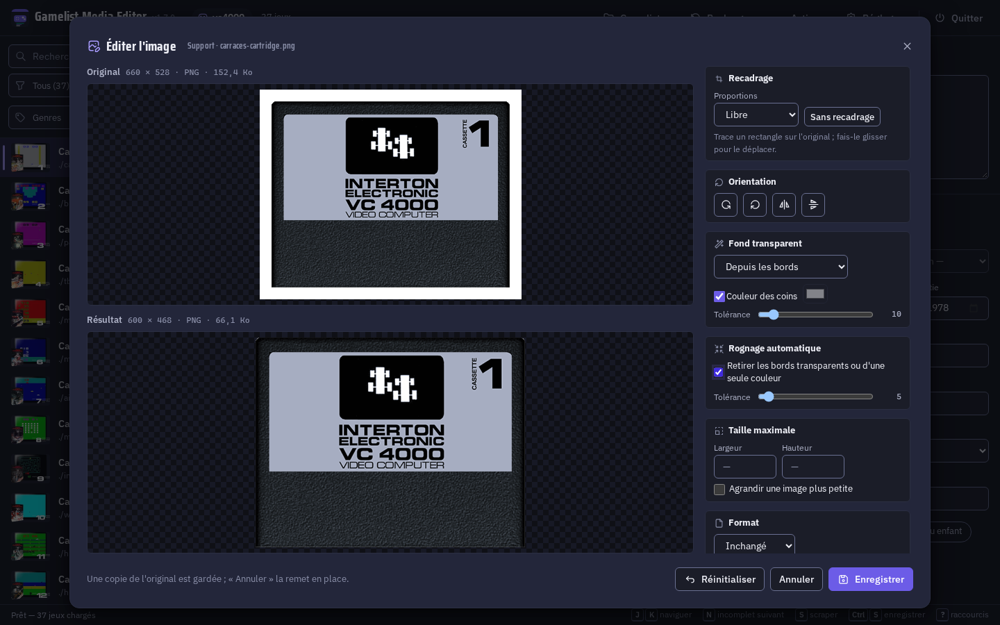
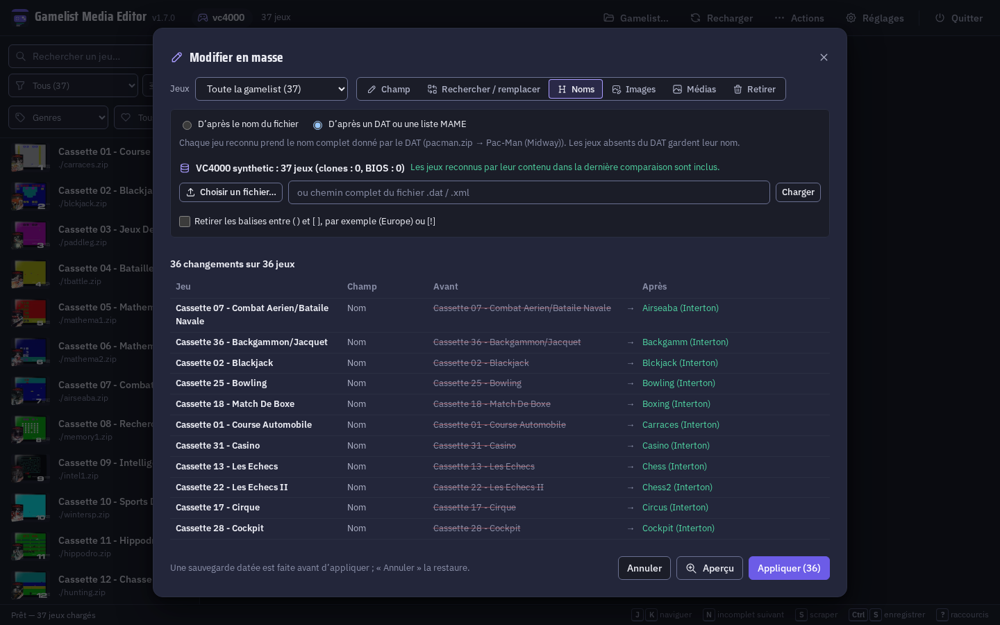
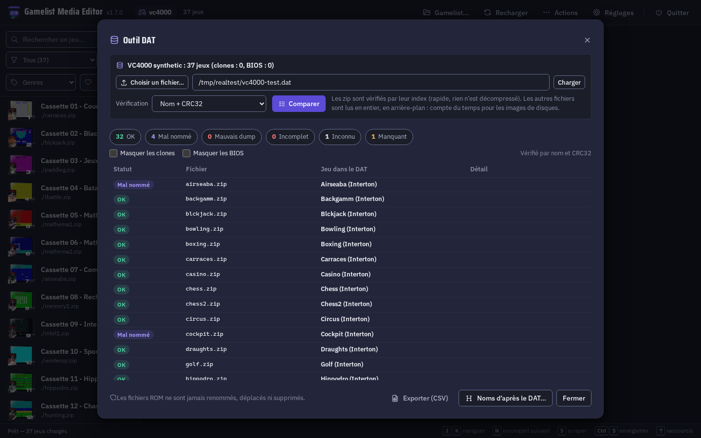

# Gamelist Media Editor v1.7.0

Faster batch scrapes that stay within your ScreenScraper limits, many games edited at once, a DAT tool, and a built-in image editor.

## Highlights

**Parallel batch scrape, within your ScreenScraper limits**
- With a member login, the batch scrape handles several games at once. It never runs more than the `maxthreads` ScreenScraper gives the account entered in **Settings › ScreenScraper**. Without a login it stays at 1.
- The whole app shares the account's limits: requests per minute, daily quota, and the 429 / 430 / 431 answers. Results are still written in list order.
- **Settings › ScreenScraper › Threads** can lower the number of threads, never raise it. The batch window shows *Threads: x/y*.
- A batch can be **resumed** after a stop or restart (*Last batch*), and **Retry failures** retries only what failed.

**ScreenScraper answer cache**
- Game lookups are kept on disk for 30 days (*Game not found* for only 1 day; errors are never kept). Scraping a game again sends no request and uses none of your quota.
- Credentials are never stored. The cache can be turned off, kept for longer or shorter, emptied, or ignored for one scrape.

**Media type per media; wheel, titleshot and music**
- **Settings › ScreenScraper media**: for each media, choose the ScreenScraper type (`box-2D` / `box-3D`, `wheel` / `wheel-hd`, `ss` / `sstitle`, `mixrbv1` / `mixrbv2`…) and the region to try first, or turn it off.
- **wheel**, **titleshot** and **music** are full media in the editor. Music has an audio player.
- Downloaded images are checked before they are written. Corrupt, tiny or single-colour pictures are refused.

**Image editor** (new button on every image tile)
- Crop (free or at a fixed ratio), rotate and flip.
- Make the background **transparent**: only from the edges for logos, or one colour everywhere.
- **Auto-trim** borders, set a maximum size, and convert to PNG / JPG / WebP with a quality setting.
- The preview updates live. *Save* keeps a copy of the original, either replacing the file or writing a new `-edit` file, and the toast's **Undo** puts it back.
- **Edit in bulk › Images** trims, resizes or converts one media type of many games at once.

**Edit in bulk** (Actions, or the pencil in the selection bar)
- Set a field, **find / replace** (plain text or regular expression), names from the ROM file or from a DAT / MAME list, remove media tags, remove games.
- Every change is previewed before → after. Each apply makes a dated backup first, and its toast offers **Undo**. ROMs are never deleted.
- **Backups** (Actions) lists the last 30 dated copies of the gamelist and can restore any of them.

**DAT tool and new gamelists**
- Load a No-Intro, Redump, FBNeo or MAME DAT you have and compare your ROMs with it, by name or by CRC32 / SHA1. The report shows OK, misnamed, bad dump, incomplete, unknown and missing games, and exports to CSV. ROM files are never renamed, moved or deleted.
- **Create a gamelist here…** builds a `gamelist.xml` from a ROM folder, using the usual extensions of the system.

**Game list**
- **Resizable** game list: drag its edge and the media tiles shrink in real time.
- Filters by **genre** and by **favorite / hidden / kids**, a **column filter**, and search in every field.
- `Ctrl+A` ticks every game shown. You can copy the ROM paths of the ticked games and **export the list to CSV**.
- **Statistics** (Actions): media present / broken / missing, scraped and complete games, genres.

## Fixes

- A gamelist operation keeps the same file and media folder from start to end. Requests from an older tab or batch are refused once another gamelist is open.
- A locked file is never truncated: the save is reported as failed instead.
- Edits typed while a save is pending stay marked as unsaved. An upload that finishes after you change game updates the right game.
- Batch reports show every download error of partly updated games.

Full list: [CHANGELOG.md](https://github.com/Kraran/gamelist-media-editor/blob/v1.7.0/CHANGELOG.md)

## Downloads

| File | Description |
|------|-------------|
| `GamelistMediaEditor-Windows-v1.7.0.zip` | Standalone Windows `.exe` (no Python needed) |
| Source code (zip / tar.gz) | Python 3.9+ (`pip install -r requirements.txt`) |

## Upgrade from 1.6.0

Replace the app files and keep `screenscraper_config.json`, `ui_settings.json` and `recent_gamelists.json`. Nothing to migrate, and there is no new dependency.

- The ScreenScraper media types keep their 1.6.0 defaults: **wheel** and **titleshot** stay off until you tick them in **Settings › ScreenScraper media**.
- New folders appear next to the app: `cache/ss-api/` (the answer cache, safe to delete) and `state/batches/` (resumable batches).
- Next to each gamelist, `.gme-backups/` holds the dated backups and the originals of edited images.

From a version before 1.5.0, see the [1.5.0 notes](https://github.com/Kraran/gamelist-media-editor/blob/v1.7.0/docs/release-notes/RELEASE_NOTES_v1.5.0.md) (Send2Trash dependency for source runs, settings moved to `ui_settings.json`).
