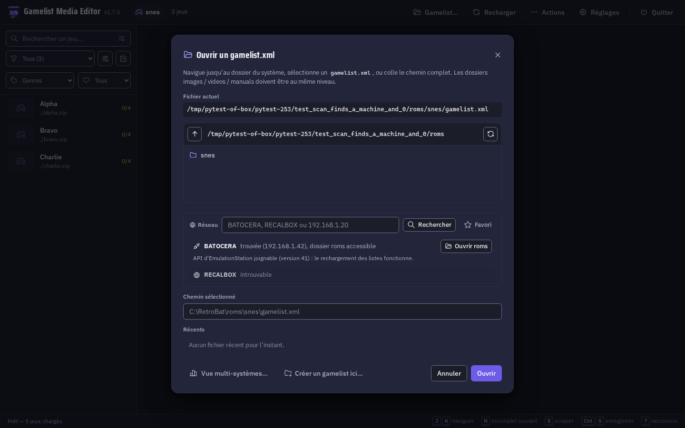

# Gamelist Media Editor v1.7.5

Open and save gamelists straight on Batocera, Recalbox or a RetroBat PC, full support for ES-DE, fallback scrape sources when ScreenScraper is missing something or has reached its quota, and actions on several systems at once.

## Highlights

**Network shares** (Batocera, Recalbox, RetroBat PC)
- Open and save a gamelist and its media directly on the machine through its SMB share (`\\BATOCERA\share`, `\\RECALBOX\share`…), no manual copy.
- *Gamelist… › Network › Search* finds the machines (or a name / IP you type) and opens their `roms` folder. Type a UNC path in the path field.
- Favourites, sign-in form for protected shares (Batocera *Enforce security*), short time limits and clear messages when the machine is off, atomic saves, dated backups kept on this PC, optional reload of the game lists through Batocera's EmulationStation API.

**ES-DE support**
- Open `ES-DE/gamelists/<system>/gamelist.xml` (installer or Windows portable). GME detects the layout and works the ES-DE way: media by ROM name in `downloaded_media/<system>/<type>/`, no media tags written to the gamelist.
- Overview of the ES-DE installation, badge next to the system name.

**Fallback scrape sources** (*Settings › Fallback sources*)
- LaunchBox Games Database (no key, free daily database), TheGamesDB (your API key) and IGDB (your Twitch application) fill what ScreenScraper does not have, or take over when its quota is reached.
- Chain order, field × source grid, chips in the scrape window showing the source of each field.

**Multi-system overview and actions**
- Open a whole `roms` folder and see every system with counts of games, missing ROMs, media present…
- Tick systems and run *Actions on ticked systems…*: ROM check, media check, solid images, clear fields and scrape, one system at a time, with progress and a final report. ScreenScraper stays within your limits.

**Other**
- *Edit in bulk › Clear fields* and *Solid images* (single-colour or transparent pictures).
- Loading spinner on every wait, status bar and slow buttons.

## Fixes

- DAT tool: report marked `aria-busy` while loading.

Full list: [CHANGELOG.md](https://github.com/Kraran/gamelist-media-editor/blob/v1.7.5/CHANGELOG.md)

## Downloads

| File | Description |
|------|-------------|
| `GamelistMediaEditor-Windows-v1.7.5.zip` | Standalone Windows `.exe` (no Python needed) |
| Source code (zip / tar.gz) | Python 3.9+ (`pip install -r requirements.txt`) |

## Upgrade from 1.7.0

Replace the app files and keep `screenscraper_config.json`, `ui_settings.json` and `recent_gamelists.json`. Nothing to migrate, and there is no new dependency.

New folders may appear next to the app: `cache/launchbox/`, `cache/sources-api/`, `network_places.json`, `network_credentials.json`, `sources_config.json` (git-ignored).
