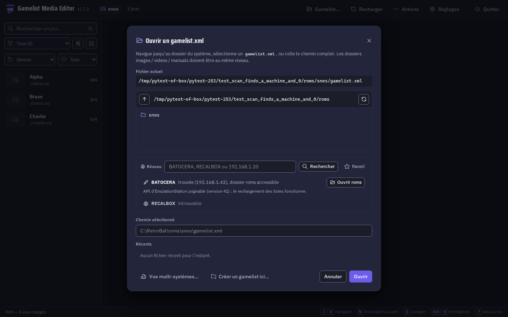
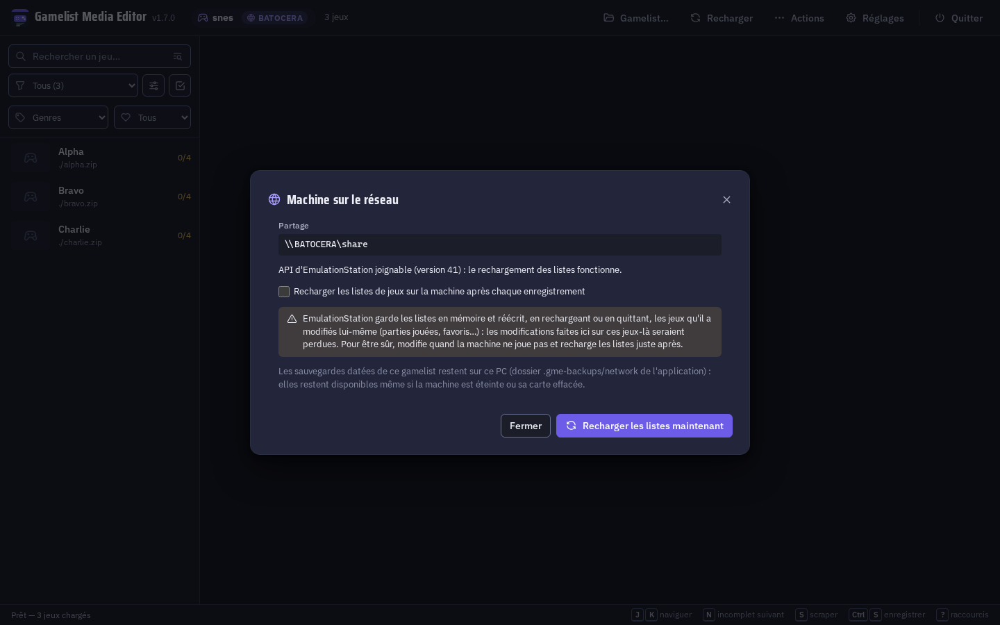

# Réseau (Batocera, Recalbox, PC RetroBat)

GME peut ouvrir et enregistrer un gamelist **directement sur la machine**, par son partage réseau (SMB), sans copier les fichiers à la main. Les médias (images, vidéos, manuels) sont écrits au même endroit, sur la machine.

## Les partages par défaut

| Machine | Partage | Identifiants | Source |
| --- | --- | --- | --- |
| Batocera | `\\BATOCERA\share` (dossier `roms` dedans) | aucun par défaut ; avec *Sécurité renforcée* : utilisateur `root` et le mot de passe affiché dans *Paramètres système › Sécurité* | [wiki Batocera : security](https://wiki.batocera.org/security), [network_issues](https://wiki.batocera.org/network_issues) |
| Recalbox | `\\RECALBOX\share` (dossier `roms` dedans) | aucun (partage ouvert en lecture/écriture) | [wiki Recalbox : gestion des fichiers](https://wiki.recalbox.com/en/basic-usage/file-management) |
| PC RetroBat | le dossier que tu as partagé toi-même (par exemple `\\MONPC\RetroBat`) | ceux du compte Windows de ce PC | — |

Si le nom ne répond pas (vieux routeur, réseau « public »), utilise l'**adresse IP** de la machine : `\\192.168.1.42\share`. Batocera et Recalbox l'affichent dans leurs paramètres réseau.

## Ouvrir un gamelist sur la machine

1. *Gamelist…* : dans le bloc **Réseau**, clique **Rechercher**. GME cherche `BATOCERA` et `RECALBOX` (et la machine que tu tapes : nom ou adresse IP) : nom, partage SMB (port 445), dossier `roms`, API d'EmulationStation.
2. **Ouvrir roms** affiche le dossier `roms` de la machine ; navigue jusqu'au système et ouvre son `gamelist.xml`.
3. Ou tape directement le chemin dans *Chemin sélectionné* puis **Entrée** : `\\BATOCERA\share\roms\snes`. `\\BATOCERA` seul liste les partages de la machine.
4. **Favori** garde le dossier affiché (local ou réseau) en raccourci, en haut du bloc Réseau. La croix le retire.



Un badge avec le nom de la machine s'affiche à côté du système quand le gamelist ouvert est sur le réseau (chemin `\\…`, lecteur réseau mappé comme `Z:`, ou partage monté sous Linux/macOS).

### Partage protégé par mot de passe

Si le partage demande un utilisateur (Batocera avec *Sécurité renforcée*), GME affiche un petit formulaire : utilisateur `root`, le mot de passe, **Se connecter**. La connexion vaut pour la session Windows. **Mémoriser sur ce PC** l'enregistre dans `network_credentials.json` à côté de l'application (jamais dans le dépôt, jamais dans le journal) pour se reconnecter tout seul la prochaine fois ; décoché, il est oublié.

Windows 10/11 refuse parfois les partages **invités** (sans mot de passe) de Recalbox et Batocera : la machine apparaît mais ne s'ouvre pas, ou Windows réclame un mot de passe qui n'existe pas. La documentation [Recalbox](https://wiki.recalbox.com/en/tutorials/network/share/access-network-share) donne la commande à lancer dans PowerShell en administrateur :

```powershell
Set-SmbClientConfiguration -EnableInsecureGuestLogons $true
```

## Machine éteinte ou réseau lent

- Avant chaque ouverture, GME vérifie en une ou deux secondes que la machine répond ; sinon il le dit tout de suite (*introuvable sur le réseau*) au lieu de bloquer.
- Une liste de dossier qui prend plus de 12 secondes est abandonnée avec un message et un bouton **Réessayer**.
- Les gamelists récents sur le réseau restent dans la liste même quand la machine est éteinte (GME ne l'interroge pas pour les afficher).

## Enregistrement et sauvegardes

- Chaque enregistrement est **atomique** : GME écrit un fichier temporaire à côté du gamelist, sur la machine, puis le renomme. Une coupure réseau pendant l'écriture laisse l'ancien gamelist intact, jamais un fichier vide ou à moitié écrit.
- Les **sauvegardes datées** (*Actions › Sauvegardes*) d'un gamelist réseau restent **sur ce PC**, dans `.gme-backups/network/<machine>/<partage>/…` à côté de l'application. Pourquoi : une sauvegarde doit survivre à ce dont elle protège (machine éteinte, carte SD pleine ou réinstallée) ; la restaurer ne dépend pas du réseau ; et 30 copies ne sont pas écrites en Wi-Fi sur la carte de la console. La copie `gamelist.xml.bak` reste à côté du gamelist, comme avant.

## Recharger les listes sur la machine

EmulationStation lit les gamelists au démarrage et les garde en mémoire : il faut **recharger les listes** pour voir les modifications. Clique le badge de la machine :



- **Batocera** (et les EmulationStation qui ont le même serveur web, comme RetroBat) : GME utilise l'API documentée d'EmulationStation, `GET http://BATOCERA:1234/reloadgames` ([wiki Batocera : es-webserver](https://wiki.batocera.org/es-webserver)). Par défaut, cette API ne répond qu'à la machine elle-même : active **Paramètres système › Options développeur du frontend › Autoriser l'accès web public**, puis redémarre. **Recharger les listes maintenant** le fait tout de suite ; **Recharger… après chaque enregistrement** le fait quelques secondes après le dernier enregistrement (une seule fois pour plusieurs enregistrements à la suite).
- **Recalbox** n'a pas d'API documentée pour recharger les listes. D'après [sa documentation](https://wiki.recalbox.com/en/advanced-usage/scripts-on-emulationstation-events), l'interface redémarre d'elle-même quand un `gamelist.xml` est modifié de l'extérieur ; sinon : *START › Mettre à jour les listes de jeux*.

> **Attention.** EmulationStation réécrit, en rechargeant ou en quittant, les jeux qu'il a modifiés lui-même pendant qu'il tournait (parties jouées, temps de jeu, favoris…). Les modifications faites dans GME sur **ces jeux-là** seraient perdues ; les autres jeux ne sont pas touchés (Batocera relit le fichier et n'y remplace que les jeux qu'il a modifiés). Pour être sûr : modifie quand la machine n'est pas en train de jouer, et recharge les listes juste après.

## Linux et macOS

Les chemins `\\MACHINE\partage` sont une fonction de Windows (l'exécutable de GME est pour Windows). Sous Linux ou macOS, monte d'abord le partage (`smb://BATOCERA/share` dans le gestionnaire de fichiers, ou `mount -t cifs`) puis ouvre le dossier monté : GME le reconnaît comme partage réseau (badge, sauvegardes locales, rechargement).

## Limites

- La **vue multi-systèmes** sur un dossier `roms` réseau fonctionne, mais sans délai maximal : sur une machine lente, la première analyse peut être longue.
- Si la machine s'éteint pendant que le gamelist est ouvert, les actions attendent la réponse de Windows (jusqu'à une minute environ) avant d'afficher une erreur.
- Pas de connexion SMB intégrée hors de Windows (il faut monter le partage).
